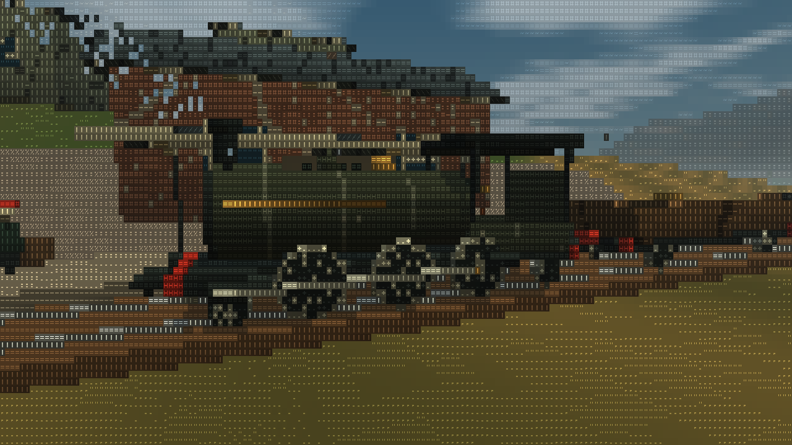

# Next Stop

A small rural railway game made of coloured letters. Take a steam train through fields, woods and mountain weather, stop at country stations, or leave the cab to explore on foot.



**Desktop prototype · v0.2.0 · MIT license**

## Download and play

1. [Download next-stop.html](https://github.com/Taan1el/next-stop/raw/refs/heads/main/outputs/next-stop.html). If your browser displays the source, save it as `next-stop.html`.
2. Open the downloaded file in a desktop browser with WebGL2 and hardware acceleration enabled.
3. Choose a service and select **Start journey**. Press **E** beside the locomotive to board.

The player needs only that HTML file. No installation, server, internet connection, images, imported models or game engine are required. The MIT notice is included inside the file.

Keyboard and mouse are required. Windows Chromium-based browsers have been tested; other WebGL2 browsers are not yet verified. Mobile touch controls are not implemented.

## Life on the branch line

- **Goods train:** mixed farm freight, heavier timber wagons or prompt mail.
- **Passenger local:** carry workers and market passengers; wait for boarding before serving each stop.
- **Free running:** drive and explore without delivery obligations.
- **Steam operation:** tend the fire, watch pressure, brake for the bridge and whistle at crossings. An optional automatic fireman makes driving more relaxed.
- **Walking:** visit six trackside places and keep their notes in the journal.
- **Station work:** carry parcels to local porters, refill lamps and sort addressed letters. Nine jobs earn shillings and a village reputation.
- **A personal engine:** spend station-work earnings on green or ochre boiler paint; owned colours remain available to switch for free.
- **After dark:** moonlight keeps paths and hills readable, station lamps light the platforms, and a hand lantern follows you on foot.
- **A moving world:** wind in the trees, drifting smoke and clouds, firelight, lamps, changing weather and water reflections.

The locomotive has working wheel and rod animation, a rounded boiler and cab instruments. Stations have masonry, framed windows, canopies and glyph nameboards. Steam rhythm, rail joints and station bells are synthesized by the browser.

## Controls

| Key | Action |
|---|---|
| WASD | Walk; aboard, W/S raises/lowers power |
| E | Board, serve a stopped destination, or leave |
| Space | Hold the brake |
| B / V | Add coal / whistle |
| C / F | Switch cab/chase camera / centre camera |
| R | Reverse while stopped; apply W afterward |
| Mouse or arrows | Look around |
| T | Pick up/deliver parcels, start letters; hold to refill a lamp |
| 1 / 2 / 3 | Sort an active letter to Pinebank / Bellweather / Stonehaven |
| L | Toggle the hand lantern |
| J | Journal, noticeboard, walking destinations and paint workshop |
| Esc / H | Pause / controls |

Settings includes night brightness, sound volume/mute, glyph size, weather, reduced motion, high contrast, the automatic fireman and recovery to a safe station. Open **J**, expand the noticeboard and select a job to get walking directions. Letter rounds can be cancelled there before taking different work.

## Saving a journey

Progress saves locally every ten seconds and when paused. Reopen the same file and choose **Continue last journey**. Local-file storage support varies by browser, so **Export save** in Settings is the portable backup. Import that JSON file to continue on another machine.

Completed station work, carried parcels, unfinished letter rounds, reputation and owned paint travel with the save. A lamp refill must be completed in one continuous hold.

## Build and test

Development requires **Node.js 20 or newer**. The game has no runtime dependencies; Playwright is a development-only dependency.

```sh
git clone https://github.com/Taan1el/next-stop.git
cd next-stop
npm ci
npm run build
npm test
```

Build output is [outputs/next-stop.html](outputs/next-stop.html). `npm test` runs numerical, save-fixture and renderer-resource checks plus the standalone packaging audit.

For offline browser checks:

```sh
npx playwright install chromium
npm run test:browser
```

Full real-time driving checks are separate: `npm run test:circuit` and `npm run test:passenger`. Browser runs use ordinary player controls and save local results under ignored `.omx/evidence/`.

See [testing](docs/TESTING.md) for browser selection, coverage and limitations; [architecture](docs/ARCHITECTURE.md) for the direct-glyph renderer; and [releases](docs/RELEASING.md) for creating the download package. Changes are listed in the [changelog](CHANGELOG.md).

## How it is drawn

The world is numerical terrain, material and object data. A custom WebGL2 scene pass resolves that data directly into glyph IDs and foreground/background colours. A display pass expands embedded numerical character masks. It does not render an ordinary image and apply a text filter.

Readable source is in [work/src/](work/src/). Edit source and rebuild the HTML. World generations are versioned so older saves retain their original landscape.

## License

Copyright © 2026 Taan1el. Released under the [MIT license](LICENSE).
